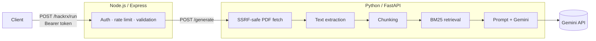

# LLM Query System

[](https://github.com/Prabodh-dev/llm-query-system/actions/workflows/ci.yml)


A production-oriented document question-answering API. Send it the URL of a PDF (an insurance policy, a contract, a handbook) and a list of questions. It returns concise, grounded answers generated by Google Gemini from the most relevant parts of the document.

It is built as two small services: a hardened **Node.js gateway** that handles authentication and traffic control, and a **Python/FastAPI service** that fetches the document, retrieves relevant passages and queries the model.

## Architecture



**Request flow**

1. The gateway authenticates the caller, rate-limits, and validates the payload.
2. The LLM service downloads the PDF, extracts text page by page and splits it into overlapping chunks.
3. For each question, BM25 ranks the chunks and the top matches are selected, so the prompt stays small regardless of document length.
4. Gemini receives the shared excerpt list and the questions and returns a JSON array of answers, validated to have exactly one answer per question, in order.

## Features

- **Retrieval before generation.** Chunked, page-tagged passages ranked with BM25. Prompts stay bounded and answers can be traced to pages.
- **Grounded answers.** The model is instructed to answer only from the excerpts and to say when the document does not contain the answer. Document text is treated as untrusted to resist prompt injection.
- **Structured, validated output.** JSON mode with strict shape checking. Malformed output is retried, never passed through as an answer.
- **Resilient model calls.** Retries with exponential backoff on transient failures (429/5xx), fail-fast on permanent errors, configurable timeouts.
- **Honest error handling.** Failures return real HTTP status codes (`400`, `401`, `413`, `422`, `429`, `502`, `504`) with a stable `{ "error", "code" }` body instead of error text disguised as an answer.
- **SSRF protection.** Only public `http(s)` URLs are fetched; every redirect hop is re-validated, and private, loopback and link-local addresses (including cloud metadata endpoints) are blocked.
- **Resource limits.** Streaming download with a hard byte cap, page limit, request body limit, question count/length limits, per-IP rate limiting.
- **Security basics.** Constant-time token comparison, `helmet` headers, optional service-to-service token, non-root containers, no request bodies or prompts in logs.
- **Observability.** Structured JSON logs, request IDs propagated from gateway to LLM service and echoed in `X-Request-ID`, `/health` endpoints, graceful shutdown.
- **Tested and automated.** 68 automated tests across both services, GitHub Actions CI, Docker images and Compose setup.

## Tech stack

| Layer | Technology |
|-------|------------|
| Gateway | Node.js 22, Express 5, helmet, express-rate-limit, axios |
| LLM service | Python 3.12, FastAPI, Pydantic v2, pypdf, requests |
| Model | Google Gemini via the `google-genai` SDK |
| Testing | `node:test`, pytest |
| Delivery | Docker, Docker Compose, GitHub Actions |

## API

### `POST /hackrx/run`

```http
POST /hackrx/run
Authorization: Bearer <HACKRX_API_KEY>
Content-Type: application/json
```

```json
{
  "documents": "https://example.com/policy.pdf",
  "questions": [
    "What is the grace period for premium payment?",
    "Does the policy cover maternity expenses?"
  ]
}
```

```json
{
  "answers": [
    "A grace period of thirty days is provided for premium payment.",
    "Maternity expenses are covered after 24 months of continuous coverage."
  ]
}
```

Answers are returned in the same order as the questions.

**Errors** are always `{ "error": "<message>", "code": "<machine_code>" }`:

| Status | Code | Cause |
|--------|------|-------|
| 400 | `invalid_request`, `invalid_json`, `unsafe_url`, `document_fetch_failed` | Bad payload, blocked URL, document could not be downloaded |
| 401 | `unauthorized` | Missing or wrong bearer token |
| 413 | `payload_too_large`, `document_too_large` | Body or PDF over the size limit |
| 422 | `invalid_document` | Not a PDF, encrypted, corrupt, too many pages, or no extractable text |
| 429 | `rate_limited` | Rate limit exceeded |
| 502 | `upstream_unavailable`, `llm_unavailable`, `llm_invalid_output` | The model or LLM service failed |
| 504 | `upstream_timeout`, `llm_timeout` | The model or LLM service timed out |

### `GET /health`

Available on both services without authentication. Returns `{ "status": "ok" }`.

## Getting started

### With Docker Compose

```bash
cp backend/.env.example backend/.env   # set HACKRX_API_KEY
cp llm/.env.example llm/.env           # set GOOGLE_API_KEY
docker compose up --build
```

The gateway is then available on `http://localhost:3000`.

### Locally

Prerequisites: Node.js 20+, Python 3.10+, a Gemini API key from [aistudio.google.com](https://aistudio.google.com/apikey).

LLM service:

```bash
cd llm
python -m venv .venv && source .venv/bin/activate
pip install -r requirements-dev.txt
cp .env.example .env        # set GOOGLE_API_KEY
uvicorn app.main:app --port 8000
```

Gateway:

```bash
cd backend
npm install
cp .env.example .env        # set HACKRX_API_KEY and LLM_API_URL=http://localhost:8000/generate
npm start
```

Try it:

```bash
curl -X POST http://localhost:3000/hackrx/run \
  -H "Authorization: Bearer $HACKRX_API_KEY" \
  -H "Content-Type: application/json" \
  -d '{"documents":"https://example.com/policy.pdf","questions":["What is covered?"]}'
```

## Configuration

### Gateway (`backend/.env`)

| Variable | Default | Description |
|----------|---------|-------------|
| `HACKRX_API_KEY` | required | Token clients send as `Bearer <token>` |
| `LLM_API_URL` | required | Full URL of the LLM service `/generate` endpoint |
| `PORT` | `3000` | Listen port |
| `LLM_SERVICE_TOKEN` | – | Token sent to the LLM service if it requires one |
| `LLM_TIMEOUT_MS` | `120000` | Upstream request timeout |
| `MAX_QUESTIONS` | `50` | Maximum questions per request |
| `RATE_LIMIT_PER_MIN` | `60` | Requests per IP per minute |
| `LOG_LEVEL` | `info` | `debug`, `info`, `warn`, `error` |

The gateway refuses to start if required variables are missing or invalid.

### LLM service (`llm/.env`)

| Variable | Default | Description |
|----------|---------|-------------|
| `GOOGLE_API_KEY` | required | Gemini API key |
| `GEMINI_MODEL` | `gemini-2.0-flash` | Model name |
| `LLM_SERVICE_TOKEN` | – | If set, callers must present it as a bearer token |
| `MAX_PDF_BYTES` | `26214400` | Maximum download size (25 MB) |
| `MAX_PDF_PAGES` | `500` | Maximum pages |
| `CHUNK_SIZE` / `CHUNK_OVERLAP` | `1000` / `150` | Chunking in characters |
| `TOP_K` | `5` | Passages retrieved per question |
| `MAX_QUESTIONS` | `50` | Maximum questions per request |
| `LLM_TIMEOUT_S` / `LLM_MAX_ATTEMPTS` | `90` / `3` | Model timeout and retry budget |
| `DOWNLOAD_TIMEOUT_S` | `30` | PDF download timeout |
| `LOG_LEVEL` | `INFO` | Log verbosity |

## Testing

```bash
cd backend && npm test                    # 23 tests
cd llm && python -m pytest -q             # 45 tests
```

The suites cover authentication, validation, error mapping, rate limiting, upstream timeouts and malformed responses, SSRF blocking (including redirects to private addresses), streaming size limits, PDF edge cases, chunking, retrieval ranking, and model retry behaviour. External services are replaced with local fakes, so no network access or API key is needed.

## Project structure

```
backend/                  Node.js gateway
  server.js               Entry point, graceful shutdown
  src/app.js              Express app, routes, error handling
  src/auth.js             Constant-time bearer auth
  src/llmClient.js        Upstream client and error mapping
  src/config.js           Fail-fast configuration
  test/                   node:test suites
llm/                      Python service
  app/main.py             FastAPI app, /generate and /health
  app/pdf.py              Safe download and text extraction
  app/security.py         SSRF guard
  app/chunking.py         Overlapping page-tagged chunks
  app/retrieval.py        BM25 index
  app/llm.py              Prompting, Gemini call, retries, output validation
  tests/                  pytest suites
docker-compose.yml
.github/workflows/ci.yml
```

## Design notes and limitations

- **Lexical retrieval.** BM25 keeps the service dependency-light and deterministic. Embedding-based or hybrid retrieval would improve recall on heavily paraphrased questions and is the natural next step.
- **Text PDFs only.** Scanned documents have no text layer and are rejected with a clear `422`; OCR is not included.
- **DNS rebinding.** URLs are validated before each request, but the connection is not pinned to the validated IP. For stricter isolation, also run the LLM service with egress rules that block internal networks.
- **Rate limiting is in-process.** Behind multiple gateway replicas, use a shared store or enforce limits at the load balancer.
- **Compatibility.** The route and variable name `HACKRX_API_KEY` are kept from the original deployment so existing clients continue to work.

## License

MIT. See [LICENSE](LICENSE).
